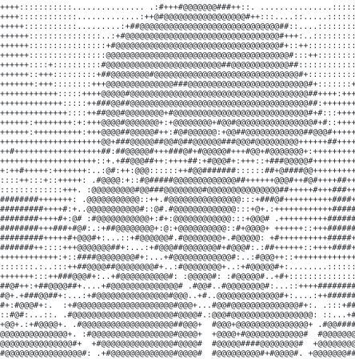

[github](https://github.com/itsprantik)

> Building in the browser and on the desktop, from India.

I make games and tools, mostly in TypeScript and Java. Right now that's
[MacOS](https://github.com/itsprantik/MacOS), a macOS-style desktop that runs
as a web app.

<samp>typescript &nbsp; java &nbsp; react &nbsp; vite &nbsp; tailwind &nbsp; zustand &nbsp; electron &nbsp; git</samp>

**[MacOS](https://github.com/itsprantik/MacOS)** &nbsp;·&nbsp; <samp>typescript, react, electron</samp> 
A macOS-style desktop in the browser: boot and login screens, draggable windows,
dock, menu bar, Control Center, widgets and a growing set of apps.

**[Redline](https://github.com/itsprantik/Redline)** &nbsp;·&nbsp; <samp>typescript</samp> 
An F1-themed typing game. The faster you type, the faster your car goes.
Practice and competition modes, with a few F1 easter eggs.

**[dino](https://github.com/itsprantik/dino)** &nbsp;·&nbsp; <samp>java</samp> 
Run Dino Run: an endless runner in Java Swing, all in a single file.

Every graphic here is generated, not embedded from anyone else's server. 
`ascii.svg` is a picture pushed through a character ramp by
[`scripts/make_portrait.py`](scripts/make_portrait.py); the stat graphics are
drawn by [a scheduled action](.github/workflows/stats.yml) straight from the
GitHub GraphQL API, once a day, committing only what changed. The section
headings come from [`scripts/make_headings.py`](scripts/make_headings.py).

They animate with SMIL inside the SVG, because GitHub strips scripts from
READMEs, and since nothing loads from a third party, nothing here can
rate-limit or go dark.

Every character is placed on an explicit grid, so the layout holds even if a
viewer's default monospace font is wider or narrower than mine.

Language totals cover public repositories only. `year.svg` uses the portrait's
character ramp: `:` `+` `#` `@`, quiet to loud.
